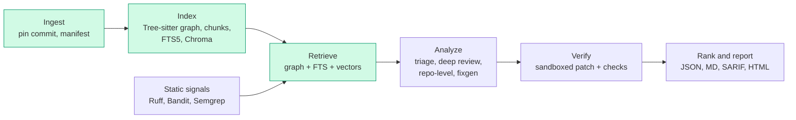

# reviewer

An AI code review tool for Python repositories. It finds problems (bugs, security, performance,
readability, architecture), explains them, and proposes fixes as diffs that are verified in a
sandbox before they are shown.

> **Status: Phase 2 of 8.** Ingest, the code graph, lexical and vector indexes, and the context
> builder work end to end. LLM analysis, verification and reports are not built yet.

## Architecture



Green boxes exist today. Everything shares one data store and every run is pinned to a commit SHA
so results can be scored later.

## Quickstart

Requires Python 3.12.

```bash
python3.12 -m venv .venv && source .venv/bin/activate
pip install -e ".[dev]"
```

(With [uv](https://docs.astral.sh/uv/) the equivalent is `uv sync --extra dev`, then prefix
commands with `uv run`.)

```bash
reviewer index path/to/python/repo     # or a git URL
reviewer query create_order --repo path/to/python/repo
reviewer context pkg/orders.py --repo path/to/python/repo --symbol create_order
```

Example output against the bundled fixture repo:

```
round_money  [function]  pkg/utils.py:1-2
  def round_money(value)
  Callers (2):
    Gateway.charge               pkg/payments.py:6  [import]
    refund                       pkg/payments.py:16  [import]
  Callees (0):
    (none)
  Unresolved/external calls: round
```

Each edge shows the rule that resolved it: `self`, `local`, `import`, `name` (unique repo-wide
match) or `ambiguous` (a few candidates). Calls that cannot be resolved (builtins, third-party
code) are listed separately instead of being guessed.

`context` prints the ContextBundle for each function in a file: what was retrieved, which
strategy found it (and at what rank), and what was dropped to stay within the token budget.
Pass `--json` for the full bundle.

```
== Gateway.charge  pkg/payments.py:5-8  [402/6000 tokens, target 49]
   0.0535  round_money  pkg/utils.py:1-2  (27 tok)
            - graph:callee #1: called from line 6 [import]
            - lexical #1: shared identifiers (BM25)
   0.0527  create_order  pkg/orders.py:19-24  (57 tok)
            - graph:caller #1: calls Gateway.charge at pkg/orders.py:21 [name]
   0.0474  test_charge_rounds  tests/check_orders.py:4-6  (40 tok)
            - graph:test #1: calls Gateway.charge at tests/check_orders.py:6 [name]
```

Indexes and clones live under `~/.cache/reviewer` (override with `REVIEWER_HOME`), never inside the
analyzed repository.

### Development

```bash
pytest
ruff check .
mypy reviewer
```

### Configuration

The Claude API key is read from the `ANTHROPIC_API_KEY` environment variable once the LLM stages
land. It is never written to disk or committed.

## Design decisions

- **Pinned runs.** A git repo is pinned to `HEAD` (and flagged if the tree is dirty). A plain
  directory is pinned to a hash of its file contents. A subdirectory of a bigger repo is treated as
  a plain directory so it never picks up an unrelated parent's commit or ignore rules.
- **Conservative call graph.** Resolution is static and name-based, so precision matters more than
  coverage: exact rules first (`self.x()`, same-file, imports with re-export following), then a
  repo-wide name match only for methods and only when the candidate set is small. Calls into
  external modules never match repo symbols.
- **Incremental indexing.** Files are re-parsed only when their content hash changes; edges are
  recomputed each run because they depend on the whole repo.
- **Language-agnostic by design.** Tree-sitter is confined to `index/parser.py`; another language
  means another adapter that returns the same `ParsedFile`.
- **One chunk per function/method**, with a header (file, class, signature) that later retrieval
  stages embed alongside the code. Nested functions stay inside their parent's chunk.
- **Retrieval: exact first, fuzzy second.** Candidates come from the code graph (callers, callees,
  tests that call the target), a BM25 index over identifiers split into sub-words, and a vector
  index. They are merged with reciprocal rank fusion (`weight / (60 + rank)`); graph signals are
  weighted above lexical, and lexical above vector. Chunks are packed greedily into a token budget
  (chars / 4 estimate), and anything dropped is recorded with the reason.
- **Embedder behind an interface.** The default `HashingEmbedder` is deterministic, offline and
  needs no model download; it matches on shared identifier sub-words, not meaning. It is the weakest
  signal and is weighted accordingly. A neural embedder is a drop-in `Embedder` implementation, and
  the vector index rebuilds itself if the embedder's name changes.
- **Sync by content hash.** Both the FTS table and the Chroma collection store each chunk's content
  hash, so unchanged chunks are never re-indexed or re-embedded.

## Roadmap

1. Ingest, chunk, graph, SQLite store (done)
2. Lexical and vector indexes, context builder (done)
3. Triage and deep review with structured findings and a run store
4. Static signals
5. Fix generation and sandbox verification
6. Repo-level pass, ranking, reports
7. Evals
8. Stretch: GitHub Action, Ollama adapter, JS/TS
