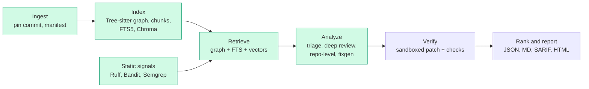

# reviewer

An AI code review tool for Python repositories. It finds problems (bugs, security, performance,
readability, architecture), explains them, and proposes fixes as diffs that are verified in a
sandbox before they are shown.

> **Status: Phase 4 of 8.** Ingest, indexes, static signals (Ruff, Bandit, Semgrep), retrieval, and
> two-stage LLM review (triage, then deep review) with structured findings and a full run trace work
> end to end. Fix generation, sandbox verification and the report formats are not built yet. The Claude calls are
> covered by tests against a fake model only; they have not yet been exercised against the live API.

## Architecture



Green boxes exist today (Analyze so far covers triage and deep review). Everything shares one data store and every run is pinned to a commit SHA
so results can be scored later.

## Quickstart

Requires Python 3.12.

```bash
python3.12 -m venv .venv && source .venv/bin/activate
pip install -e ".[dev]"
```

(With [uv](https://docs.astral.sh/uv/) the equivalent is `uv sync --extra dev`, then prefix
commands with `uv run`.)

```bash
reviewer index path/to/python/repo     # or a git URL
reviewer query create_order --repo path/to/python/repo
reviewer context pkg/orders.py --repo path/to/python/repo --symbol create_order
```

Example output against the bundled fixture repo:

```
round_money  [function]  pkg/utils.py:1-2
  def round_money(value)
  Callers (2):
    Gateway.charge               pkg/payments.py:6  [import]
    refund                       pkg/payments.py:16  [import]
  Callees (0):
    (none)
  Unresolved/external calls: round
```

Each edge shows the rule that resolved it: `self`, `local`, `import`, `name` (unique repo-wide
match) or `ambiguous` (a few candidates). Calls that cannot be resolved (builtins, third-party
code) are listed separately instead of being guessed.

`context` prints the ContextBundle for each function in a file: what was retrieved, which
strategy found it (and at what rank), and what was dropped to stay within the token budget.
Pass `--json` for the full bundle.

```
== Gateway.charge  pkg/payments.py:5-8  [402/6000 tokens, target 49]
   0.0535  round_money  pkg/utils.py:1-2  (27 tok)
            - graph:callee #1: called from line 6 [import]
            - lexical #1: shared identifiers (BM25)
   0.0527  create_order  pkg/orders.py:19-24  (57 tok)
            - graph:caller #1: calls Gateway.charge at pkg/orders.py:21 [name]
   0.0474  test_charge_rounds  tests/check_orders.py:4-6  (40 tok)
            - graph:test #1: calls Gateway.charge at tests/check_orders.py:6 [name]
```

### Static signals

`index` also runs Ruff, Bandit and Semgrep and normalises their output into one `Signal` schema
(tool, rule, file, lines, category, severity, message). Inspect them with:

```bash
reviewer signals --repo path/to/python/repo --min-severity medium
```

Ruff and Bandit are installed with the package. **Semgrep is installed separately**, because its
OpenTelemetry pins conflict with Chroma's:

```bash
python3 -m venv ~/.cache/reviewer/tools/semgrep
~/.cache/reviewer/tools/semgrep/bin/pip install semgrep
```

(or put `semgrep` on your `PATH`, or point `REVIEWER_SEMGREP` at it). A tool that is missing or
fails is reported by `index` and skipped; it never stops the run, and it is retried on the next
index. Semgrep runs offline with the rules in `reviewer/config/semgrep/python.yaml`.

### Reviewing with Claude

```bash
export ANTHROPIC_API_KEY=...            # never written to disk or committed
reviewer review path/to/python/repo --max-chunks 10
reviewer runs --repo path/to/python/repo
```

`review` indexes the repo, then for each function: a cheap triage call (Claude Haiku 5.5) decides
whether it deserves attention, and if so a deep review (Claude Sonnet 5.5) reads the function
together with its `ContextBundle` and returns findings. This calls the API and costs money, so
a hard per-run limit (`review.max_cost_usd` in `reviewer/config/settings.yaml`, default $2) stops
the run cleanly. Test files are used as context but not reviewed.

Each run writes `~/.cache/reviewer/runs/<run-id>.json`: the findings plus every model call with
its full prompt, output, model, prompt version, tokens, cost and latency (secrets redacted).

Indexes and clones live under `~/.cache/reviewer` (override with `REVIEWER_HOME`), never inside the
analyzed repository.

### Development

```bash
pytest
ruff check .
mypy reviewer
```

### Configuration

The Claude API key is read from the `ANTHROPIC_API_KEY` environment variable once the LLM stages
land. It is never written to disk or committed.

## Design decisions

- **Pinned runs.** A git repo is pinned to `HEAD` (and flagged if the tree is dirty). A plain
  directory is pinned to a hash of its file contents. A subdirectory of a bigger repo is treated as
  a plain directory so it never picks up an unrelated parent's commit or ignore rules.
- **Conservative call graph.** Resolution is static and name-based, so precision matters more than
  coverage: exact rules first (`self.x()`, same-file, imports with re-export following), then a
  repo-wide name match only for methods and only when the candidate set is small. Calls into
  external modules never match repo symbols.
- **Incremental indexing.** Files are re-parsed only when their content hash changes; edges are
  recomputed each run because they depend on the whole repo.
- **Language-agnostic by design.** Tree-sitter is confined to `index/parser.py`; another language
  means another adapter that returns the same `ParsedFile`.
- **One chunk per function/method**, with a header (file, class, signature) that later retrieval
  stages embed alongside the code. Nested functions stay inside their parent's chunk.
- **Retrieval: exact first, fuzzy second.** Candidates come from the code graph (callers, callees,
  tests that call the target), a BM25 index over identifiers split into sub-words, and a vector
  index. They are merged with reciprocal rank fusion (`weight / (60 + rank)`); graph signals are
  weighted above lexical, and lexical above vector. Chunks are packed greedily into a token budget
  (chars / 4 estimate), and anything dropped is recorded with the reason.
- **Embedder behind an interface.** The default `HashingEmbedder` is deterministic, offline and
  needs no model download; it matches on shared identifier sub-words, not meaning. It is the weakest
  signal and is weighted accordingly. A neural embedder is a drop-in `Embedder` implementation, and
  the vector index rebuilds itself if the embedder's name changes.
- **Sync by content hash.** Both the FTS table and the Chroma collection store each chunk's content
  hash, so unchanged chunks are never re-indexed or re-embedded.

- **Structured output only.** The model replies with JSON that is validated against a pydantic
  schema; an invalid reply is retried once with the validation error fed back, and a function that
  still fails is recorded as a stage failure instead of stopping the run. The provider SDK is
  imported in exactly one module (`llm/gateway.py`); everything else uses a small `LLM` protocol,
  which is also how the tests run without a network.
- **Precision over volume.** The deep review prompt tells the model that no findings is a good
  outcome. Findings are then filtered in code: below `min_confidence` (0.6) or pointing outside the
  target function are dropped (and counted on the run), and at most five are kept per function.
- **Cache by content.** Responses are cached by (model, prompt id and version, exact rendered
  request). The request contains the code and its retrieved context, so unchanged code costs
  nothing on a re-scan and any change to code, context, prompt version or model is a miss.
- **Prompts are versioned files** in `config/prompts/<id>.<version>.md` and the run records which
  versions were used. **Finding ids are stable** (hash of file, code hash, category, line, title)
  so runs can be compared and scored.
- **Repo content is untrusted.** Code is wrapped in delimiters the prompt declares as data,
  repository text cannot close those delimiters, review stages have no tools and no write access,
  and credentials are redacted from stored traces.
- **Static signals are hints, not truth.** Ruff runs with the repository's own config ignored and
  only correctness rules enabled; Semgrep uses a bundled offline rule pack, so results do not
  depend on settings the analysed repo controls. Signals are stored per file and refreshed only for
  changed files (or for everything when a tool, its version or its rules change). They reach the
  deep review as a separate, delimited block that the prompt says may be false positives; a finding
  can cite the signals it corresponds to, and citations of signals that were not in the bundle are
  discarded. A medium-or-higher signal forces a deep review of its function even when triage said it
  looked fine (recall), and the run counts how often that happened.
- **Not yet in the deep review:** read-only tool use (fetching extra files on demand). The
  retrieved context bundle is the only extra information the model sees.

## Roadmap

1. Ingest, chunk, graph, SQLite store (done)
2. Lexical and vector indexes, context builder (done)
3. Triage and deep review with structured findings and a run store (done)
4. Static signals (done)
5. Fix generation and sandbox verification
6. Repo-level pass, ranking, reports
7. Evals
8. Stretch: GitHub Action, Ollama adapter, JS/TS
