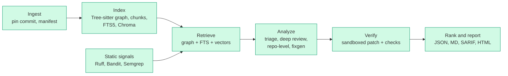

# reviewer

An AI code review tool for Python repositories. It finds problems (bugs, security, performance,
readability, architecture), explains them, and proposes fixes as diffs that are verified in a
sandbox before they are shown.

> **Status: all 8 phases built.** The full pipeline works: ingest, indexes, static signals, retrieval,
> two-stage LLM review, a repo-level architecture pass, fix generation with sandboxed verification,
> ranking, JSON / Markdown / SARIF / HTML reports, and an eval harness with seeded bugs.
> **Run live so far:** the Claude review pipeline (eval results below) and the Docker sandbox,
> including real fix verification. **Not yet run against the real thing:** Ollama, the GitHub Action, and
> JavaScript / TypeScript review (parsing and graph are tested; no model has reviewed TS code).

## Architecture



Green boxes exist today (Analyze so far covers triage, deep review and fix generation). Everything shares one data store and every run is pinned to a commit SHA
so results can be scored later.

## Quickstart

Requires Python 3.12.

```bash
python3.12 -m venv .venv && source .venv/bin/activate
pip install -e ".[dev]"
```

(With [uv](https://docs.astral.sh/uv/) the equivalent is `uv sync --extra dev`, then prefix
commands with `uv run`.)

```bash
reviewer index path/to/python/repo     # or a git URL
reviewer query create_order --repo path/to/python/repo
reviewer context pkg/orders.py --repo path/to/python/repo --symbol create_order
```

Example output against the bundled fixture repo:

```
round_money  [function]  pkg/utils.py:1-2
  def round_money(value)
  Callers (2):
    Gateway.charge               pkg/payments.py:6  [import]
    refund                       pkg/payments.py:16  [import]
  Callees (0):
    (none)
  Unresolved/external calls: round
```

Each edge shows the rule that resolved it: `self`, `local`, `import`, `name` (unique repo-wide
match) or `ambiguous` (a few candidates). Calls that cannot be resolved (builtins, third-party
code) are listed separately instead of being guessed.

`context` prints the ContextBundle for each function in a file: what was retrieved, which
strategy found it (and at what rank), and what was dropped to stay within the token budget.
Pass `--json` for the full bundle.

```
== Gateway.charge  pkg/payments.py:5-8  [402/6000 tokens, target 49]
   0.0535  round_money  pkg/utils.py:1-2  (27 tok)
            - graph:callee #1: called from line 6 [import]
            - lexical #1: shared identifiers (BM25)
   0.0527  create_order  pkg/orders.py:19-24  (57 tok)
            - graph:caller #1: calls Gateway.charge at pkg/orders.py:21 [name]
   0.0474  test_charge_rounds  tests/check_orders.py:4-6  (40 tok)
            - graph:test #1: calls Gateway.charge at tests/check_orders.py:6 [name]
```

### Static signals

`index` also runs Ruff, Bandit and Semgrep and normalises their output into one `Signal` schema
(tool, rule, file, lines, category, severity, message). Inspect them with:

```bash
reviewer signals --repo path/to/python/repo --min-severity medium
```

Ruff and Bandit are installed with the package. **Semgrep is installed separately**, because its
OpenTelemetry pins conflict with Chroma's:

```bash
python3 -m venv ~/.cache/reviewer/tools/semgrep
~/.cache/reviewer/tools/semgrep/bin/pip install semgrep
```

(or put `semgrep` on your `PATH`, or point `REVIEWER_SEMGREP` at it). A tool that is missing or
fails is reported by `index` and skipped; it never stops the run, and it is retried on the next
index. Semgrep runs offline with the rules in `reviewer/config/semgrep/python.yaml`.

### Other languages, local models, CI and pull requests

```bash
reviewer scan path/to/repo --lang python --lang typescript   # JavaScript / TypeScript (experimental)
reviewer scan path/to/repo --provider ollama                 # a local model instead of Claude
reviewer scan . --diff-base origin/main                      # only functions changed since a ref
reviewer pr --repo .                                         # branch of verified fixes + the commands to publish
```

- **JavaScript / TypeScript** (`.js .jsx .mjs .cjs .ts .tsx`) are parsed with the same Tree-sitter
  approach as Python. The call graph follows relative imports, `export … from` re-exports,
  `require`, namespace and default imports, `this.method()` and `new X()`. Python stays the default;
  other languages are opt-in with `--lang` or `languages:` in `settings.yaml`. Limits: no static
  signals (Ruff, Bandit and Semgrep are Python tools), no path aliases or package imports, and
  fixes are checked for apply and syntax only, because the sandbox image has no Node, so they end
  up `fix_unverified`.
- **Ollama** runs every stage on a local model (`--provider ollama`, or `provider: ollama`). Model
  names and the context size live under `ollama:` in `settings.yaml`; `OLLAMA_HOST` is honoured.
  Cost is zero. Quality and JSON reliability depend on the model, and nothing here has been
  measured against a real one, so use `reviewer eval run --provider ollama` before trusting it.
- **`--diff-base REF`** limits a run to the functions whose lines changed since the merge-base with
  `REF`, which is what keeps a pull-request review cheap. It needs full git history.
- **GitHub Action** ([action.yml](action.yml), example workflow in
  [examples/github-actions](examples/github-actions/reviewer.yml)): reviews a pull request's
  changes, adds the report to the job summary and uploads SARIF to code scanning. Inputs reach the
  scripts as environment variables, never interpolated into them; the example uses `pull_request`
  (not `pull_request_target`), skips fork PRs because they have no secrets, and asks for minimal
  permissions. The Action has not been run on GitHub; its structure is covered by tests.
- **`reviewer fix-branch` / `reviewer pr`** turn verified fixes into one commit each on a new local
  branch (hooks disabled; refuses a dirty tree, a moved HEAD or a detached HEAD, and never touches
  your checked-out branch). `pr` also writes the pull-request text and prints the exact `git push`
  and `gh pr create` commands. **Nothing is pushed unless you pass `--create` and answer yes** to
  those commands, and there is no flag that skips the question. Fixes are verified one at a time, so
  the PR text says they have not been tested together.

### Evals

```bash
reviewer eval retrieval            # free: how well each retrieval strategy finds the context a bug needs
reviewer eval run --dry-run        # estimate the cost first
reviewer eval run --max-cost 3     # precision, recall, fix quality on 17 planted bugs (costs money)
```

Eight small repos with 17 seeded bugs (logic, security, performance), a bug-free control case, and
tests that fail when a bug is present. Because we plant the bugs, ground truth is exact. Retrieval
quality is measured separately from the model, and so is where recall is lost (triage versus deep
review). See [evals/README.md](evals/README.md) for the case format, metrics and limits.

#### Live results

`reviewer eval run --include-clean` on the shipped cases, with `claude-haiku-5-5` for triage and
`claude-sonnet-5-5` for deep review and fixes, and the Docker sandbox running. Two runs cost $0.57
in total; later runs are cached and free.

| | |
|---|---|
| Seeded bugs found | **15 of 17** (precision 94%, recall 88%, F1 0.91) |
| Critical / high / medium bugs found | 13 of 13 |
| Low-severity bugs found | 2 of 4 |
| Category label correct on found bugs | 15 of 15 |
| False positives on clean code | 0 in 38 functions |
| Mean confidence, true vs false positives | 0.94 vs 0.85 |
| Fixes produced for found bugs | 15 of 15 |
| Fix identical to the original code (strict) | 12 of 15 |
| Fix reached `verified_fix` in the sandbox | 13 of 15 |
| Fix turns the case's failing tests green (isolated per bug) | **14 of 14** measurable |

Where recall was lost: one low-severity performance bug never got past triage (the function
looked fine to the cheap model), and one low-severity timing leak was reviewed but judged not worth
reporting. The one remaining false positive is a second report, in the same function, of the symptom
of a planted bug; the one-finding-per-bug scoring counts that as a false positive.

The two fixes that did not reach `verified_fix` are both in the `pagination` case. Its two seeded
bugs make every test fail before the patch, so the sandbox has no passing baseline to prove "nothing
regressed" against and labels the fix `fix_unverified`. The tests-flip check shows both fixes do
work. The three fixes that are not identical to the original code are all equivalent rewrites; for
the ones whose bugs the tests can see, the tests pass.

How to read this:

- **It is two runs on 17 synthetic bugs.** Model output varies between runs and the sample is
  small, so treat it as evidence that the pipeline works and behaves sensibly, not as a benchmark.
  Planted bugs are also easier than real ones.
- **Two things were corrected after the first run, and both are disclosed here.** The `inventory`
  case's clean code accepted negative quantities, which the model rightly flagged, so the fixture
  was fixed (the first run showed 3 false positives and 2.6 per 100 clean functions; the rerun
  shows 1 and 0). And the first measurement of "tests turn green" read 1 of 14, because a case with
  several seeded bugs was judged against all of its failing tests at once; it now reverts the other
  seeded bugs so each fix is judged on its own. Scoring rules for detection were not changed.
- Confidence separated real bugs from noise on this data, but the thresholds were not tuned on it.

Retrieval on the shipped cases (no model involved):

| strategy | recall@1 | recall@3 | MRR |
|---|---|---|---|
| graph | 0.69 | 0.88 | 0.88 |
| lexical | 0.19 | 0.56 | 0.49 |
| vector (identifier hashing) | 0.31 | 0.75 | 0.61 |
| graph + lexical | 0.69 | 1.00 | 0.94 |
| fused (all) | 0.69 | 1.00 | 0.94 |

The exact code graph is the strongest single signal, fusion beats any one strategy, and the offline
vector index adds nothing over graph + lexical at this scale. That is the case for a real
embedding model, and the point of measuring.

### Full scan and reports

```bash
reviewer scan path/to/python/repo              # index, review, architecture pass, fixes, reports
reviewer scan path/to/python/repo --no-fix     # skip fix generation and the sandbox
reviewer report --repo path/to/python/repo     # re-render the latest run; no LLM calls
```

`scan` writes four files to `~/.cache/reviewer/reports/<run-id>/` (or `--out DIR`):

| file | purpose |
|---|---|
| `report.json` | source of truth: ranked findings, fixes, verification results, architecture facts |
| `report.md` | readable report with diffs and the checks behind each fix status |
| `report.sarif` | SARIF 2.1.0 for GitHub code scanning and other tools; verified and unverified fixes are included as SARIF `fixes` |
| `report.html` | one static page: no scripts, no external resources, a strict CSP, all text escaped |

Findings are deduplicated (same file, category and overlapping lines) and ranked by
`severity × confidence × (1 + log2(1 + blast radius))`. Blast radius is the number of distinct
non-test functions that call the flagged function within three hops, or, for architecture
findings, the modules that import the flagged module within three hops.

The **repo-level pass** builds a module dependency graph from the import data, finds import cycles
and the most depended-on modules deterministically, asks a cheap model for a one-sentence summary
of each module, and then asks the stronger model for architecture findings that cite those facts.
Findings that name modules that do not exist, or fall below the confidence bar, are dropped.

### Fixes and sandbox verification

```bash
reviewer sandbox-build                         # once; needs network and a running Docker
reviewer review path/to/repo --fix             # generate and verify fixes
reviewer verify path/to/repo my-change.diff    # check any patch, no LLM involved
```

With `--fix`, each finding at or above `fix.min_severity` (default medium) gets a fix attempt,
and the diff is then checked in a Docker container with no network, no capabilities, no host
environment variables and a read-only root, mounted only on a throwaway copy of the repo. Each
check compares against an unpatched baseline, so existing problems are not blamed on the fix. A
finding ends up as:

| status | meaning |
|---|---|
| `verified_fix` | patch applies, parses, adds no Ruff or mypy errors, and the repo's tests ran (at least one passed before the patch) with no regressions |
| `fix_unverified` | nothing failed, but tests could not run (none exist, dependencies missing in the image) or Docker was unavailable |
| `fix_failed` | the patch does not apply, breaks syntax, adds lint or type errors, or breaks a passing test |
| `no_fix` | no fix was produced (declined, invalid, too large, or below the severity cut-off) |

"Verified" means the fix breaks nothing the sandbox could check. It does not prove the reported
problem is gone. The sandbox image has only Ruff, mypy and pytest, so repositories with
third-party dependencies will usually end up `fix_unverified` rather than `verified_fix`.

### Reviewing with Claude

```bash
export ANTHROPIC_API_KEY=...            # never written to disk or committed
reviewer review path/to/python/repo --max-chunks 10
reviewer runs --repo path/to/python/repo
```

`review` indexes the repo, then for each function: a cheap triage call (Claude Haiku 5.5) decides
whether it deserves attention, and if so a deep review (Claude Sonnet 5.5) reads the function
together with its `ContextBundle` and returns findings. This calls the API and costs money, so
a hard per-run limit (`review.max_cost_usd` in `reviewer/config/settings.yaml`, default $2) stops
the run cleanly. Test files are used as context but not reviewed.

Each run writes `~/.cache/reviewer/runs/<run-id>.json`: the findings plus every model call with
its full prompt, output, model, prompt version, tokens, cost and latency (secrets redacted).

Indexes and clones live under `~/.cache/reviewer` (override with `REVIEWER_HOME`), never inside the
analyzed repository.

### Development

```bash
pytest
ruff check .
mypy reviewer
```

### Configuration

The Claude API key is read from the `ANTHROPIC_API_KEY` environment variable once the LLM stages
land. It is never written to disk or committed.

## Design decisions

- **Pinned runs.** A git repo is pinned to `HEAD` (and flagged if the tree is dirty). A plain
  directory is pinned to a hash of its file contents. A subdirectory of a bigger repo is treated as
  a plain directory so it never picks up an unrelated parent's commit or ignore rules.
- **Conservative call graph.** Resolution is static and name-based, so precision matters more than
  coverage: exact rules first (`self.x()`, same-file, imports with re-export following), then a
  repo-wide name match only for methods and only when the candidate set is small. Calls into
  external modules never match repo symbols.
- **Incremental indexing.** Files are re-parsed only when their content hash changes; edges are
  recomputed each run because they depend on the whole repo.
- **Language-agnostic by design.** Tree-sitter is confined to `index/parser.py`; another language
  means another adapter that returns the same `ParsedFile`.
- **One chunk per function/method**, with a header (file, class, signature) that later retrieval
  stages embed alongside the code. Nested functions stay inside their parent's chunk.
- **Retrieval: exact first, fuzzy second.** Candidates come from the code graph (callers, callees,
  tests that call the target), a BM25 index over identifiers split into sub-words, and a vector
  index. They are merged with reciprocal rank fusion (`weight / (60 + rank)`); graph signals are
  weighted above lexical, and lexical above vector. Chunks are packed greedily into a token budget
  (chars / 4 estimate), and anything dropped is recorded with the reason.
- **Embedder behind an interface.** The default `HashingEmbedder` is deterministic, offline and
  needs no model download; it matches on shared identifier sub-words, not meaning. It is the weakest
  signal and is weighted accordingly. A neural embedder is a drop-in `Embedder` implementation, and
  the vector index rebuilds itself if the embedder's name changes.
- **Sync by content hash.** Both the FTS table and the Chroma collection store each chunk's content
  hash, so unchanged chunks are never re-indexed or re-embedded.

- **Structured output only.** The model replies with JSON that is validated against a pydantic
  schema; an invalid reply is retried once with the validation error fed back, and a function that
  still fails is recorded as a stage failure instead of stopping the run. The provider SDK is
  imported in exactly one module (`llm/gateway.py`); everything else uses a small `LLM` protocol,
  which is also how the tests run without a network.
- **Precision over volume.** The deep review prompt tells the model that no findings is a good
  outcome. Findings are then filtered in code: below `min_confidence` (0.6) or pointing outside the
  target function are dropped (and counted on the run), and at most five are kept per function.
- **Cache by content.** Responses are cached by (model, prompt id and version, exact rendered
  request). The request contains the code and its retrieved context, so unchanged code costs
  nothing on a re-scan and any change to code, context, prompt version or model is a miss.
- **Prompts are versioned files** in `config/prompts/<id>.<version>.md` and the run records which
  versions were used. **Finding ids are stable** (hash of file, code hash, category, line, title)
  so runs can be compared and scored.
- **Repo content is untrusted.** Code is wrapped in delimiters the prompt declares as data,
  repository text cannot close those delimiters, review stages have no tools and no write access,
  and credentials are redacted from stored traces.
- **Static signals are hints, not truth.** Ruff runs with the repository's own config ignored and
  only correctness rules enabled; Semgrep uses a bundled offline rule pack, so results do not
  depend on settings the analysed repo controls. Signals are stored per file and refreshed only for
  changed files (or for everything when a tool, its version or its rules change). They reach the
  deep review as a separate, delimited block that the prompt says may be false positives; a finding
  can cite the signals it corresponds to, and citations of signals that were not in the bundle are
  discarded. A medium-or-higher signal forces a deep review of its function even when triage said it
  looked fine (recall), and the run counts how often that happened.
- **Fixes are edits, not hand-written diffs.** Models are unreliable at hunk headers and line
  numbers, so the fix stage asks for exact `old_text` to `new_text` replacements inside the target
  function, checks that each matches exactly once, and builds the unified diff itself. Fixes that
  are declined, ambiguous, outside the function or larger than `fix.max_changed_lines` are rejected.
- **A patch is untrusted input.** The applier refuses new, deleted, renamed or binary files,
  absolute or `..` paths, `.git`, symlinks and any file the finding was not about; hunks must match
  exactly (no fuzz); a multi-file patch is applied all-or-nothing. Nothing from the analysed repo is
  ever executed on the host: only parsing happens there, and tests, type checking (which can load
  mypy plugins) and linting run in the container.
- **Deterministic facts first.** Cycles, hubs and dependents are computed in code and handed to the
  model as facts to cite; the model is not asked to discover structure from prose. Test files are
  excluded from the module graph so they do not make everything look coupled.
- **One model of the report.** Every renderer reads the same `ScanReport`, so the formats cannot
  disagree. A test applies a SARIF fix's replacements and checks it produces the same file as
  applying the diff.
- **Reports contain untrusted text.** Markdown escapes metacharacters and lengthens code fences
  past any backtick run; the HTML escapes everything, has no script, and sets a CSP that forbids
  loading anything.
- **Not yet in the deep review:** read-only tool use (fetching extra files on demand). The
  retrieved context bundle is the only extra information the model sees.

## Roadmap

1. Ingest, chunk, graph, SQLite store (done)
2. Lexical and vector indexes, context builder (done)
3. Triage and deep review with structured findings and a run store (done)
4. Static signals (done)
5. Fix generation and sandbox verification (done; sandbox isolation tested on real Docker)
6. Repo-level pass, ranking, reports (done)
7. Evals (done; first live results below)
8. Stretch: GitHub Action, PR creation, Ollama adapter, JS/TS (done; none of it run against the live services)
